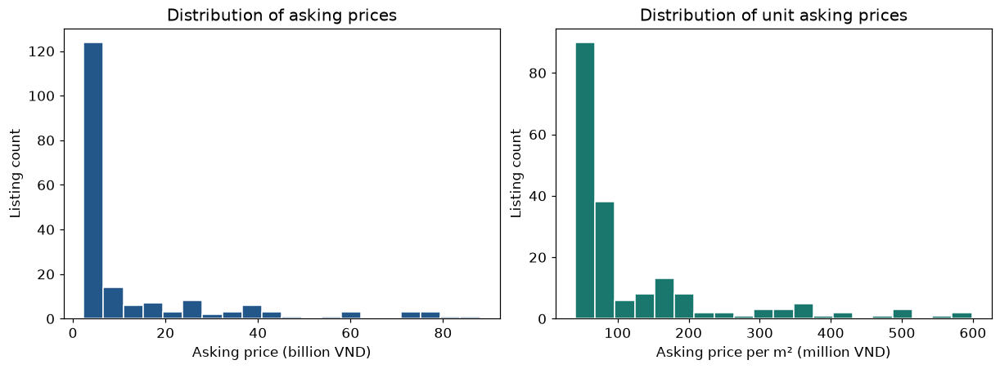
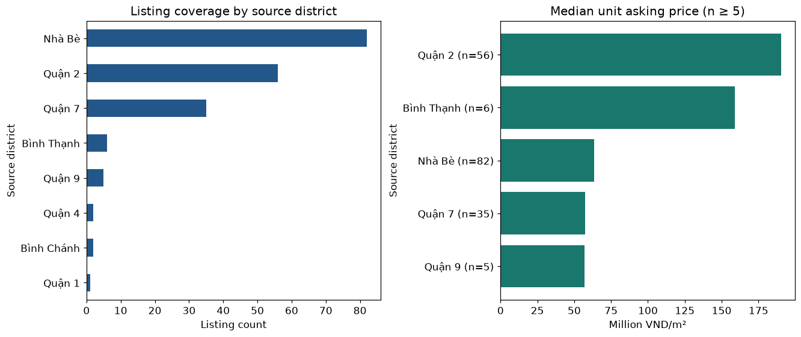
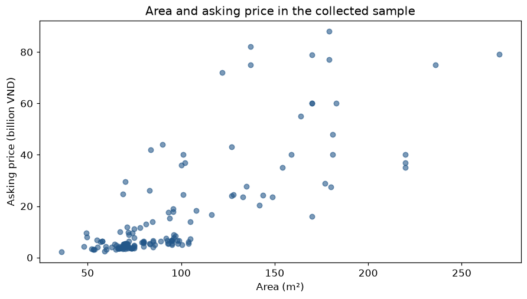

# Rever Apartment Analysis — Ho Chi Minh City

**Nguyễn Anh Khoa · Python · pandas · Data Visualization**

Dự án phân tích mẫu **189 tin đăng căn hộ từ Rever.vn** nhằm mô tả giá chào bán, đơn giá/m², diện tích và độ phủ địa bàn. Đây là dự án cá nhân phục vụ học tập và portfolio Data Analyst; chưa có tác động doanh nghiệp được đo lường.

## Xem nhanh

- [Notebook DA chính — kiểm tra dữ liệu, phân tích và kết luận](notebooks/01_rever_market_analysis.ipynb)
- [Bảng tổng hợp địa bàn](outputs/district_summary.csv)
- [Kết quả tóm tắt](outputs/findings.txt)
- [Phần mở rộng phân loại phân khúc giá](notebooks/Rever_Price_Segment_Classification_Port.ipynb)
- [Nguồn, fingerprint và môi trường](docs/provenance.json)

## Câu hỏi phân tích

1. Giá chào và đơn giá/m² phân bố ra sao trong mẫu đã thu thập?
2. Độ phủ mẫu và trung vị đơn giá khác nhau thế nào giữa các địa bàn?
3. Diện tích có quan hệ như thế nào với giá chào trong mẫu?

Một dòng là một tin đăng; không chắc là một căn hộ duy nhất. Giá chào không phải giá giao dịch. Giữ tên địa bàn theo dữ liệu nguồn, chưa quy đổi địa giới hiện hành.

## Kết quả được chạy lại

| Chỉ số | Kết quả |
|---|---:|
| Số tin trong snapshot | 189 |
| Số tin có giá/diện tích hợp lệ | 189 |
| Dòng trùng hoàn toàn / mã tin lặp | 0 / 0 |
| Ngày đăng thiếu | 189/189 |
| Trung vị giá chào | 5,30 tỷ VND |
| Trung vị đơn giá tính từ giá/diện tích | 70,00 triệu VND/m² |
| Tương quan Spearman diện tích–giá chào | 0,755 |

Nhà Bè có 82 tin, Quận 2 có 56 tin và Quận 7 có 35 tin; mẫu tập trung vào một số địa bàn, vì vậy không thể xem số tin là thị phần hoặc đại diện toàn TP.HCM. Khác biệt trung vị giữa địa bàn chưa kiểm soát loại căn hộ, diện tích, dự án và thời điểm.

### Phân bố giá



Giá chào có đuôi phải dài; báo cáo giữ nguyên các quan sát giá lớn, dùng trung vị thay vì tự động loại outlier. Giá lớn cần đối chiếu lại tin nguồn trước khi diễn giải sâu.

### Độ phủ và so sánh địa bàn



Biểu đồ trung vị chỉ hiển thị nhóm có ít nhất 5 tin; các nhóm nhỏ vẫn xuất hiện trong bảng CSV. Trung vị đơn giá cao hơn không chứng minh căn hộ bị định giá cao hoặc khu vực là cơ hội đầu tư.

### Diện tích và giá chào



Tương quan Spearman dương mô tả quan hệ thứ hạng trong mẫu, không cho phép kết luận nhân quả hay đánh giá độ chính xác của mô hình dự báo.

## Phương pháp và kiểm tra

- Kiểm tra schema, missingness, dòng trùng và mã tin lặp; không tự động xóa bản ghi.
- Chỉ số giá sử dụng tin có giá và diện tích hữu hạn, lớn hơn 0. Bản nguồn vẫn được giữ nguyên; số dòng trước/sau được đối chiếu.
- Tính lại đơn giá bằng `price_vnd / area_m2`; kiểm tra lệch hơn 1% so với trường đơn giá có sẵn.
- Trung vị và tứ phân vị không trọng số theo tin; tổng số tin của các nhóm được đối chiếu với mẫu phân tích.
- Không impute giá, không cắt outlier, không làm phân tích xu hướng vì thiếu ngày đăng.

## Ý nghĩa và bước tiếp theo

Kết quả có thể dùng để lập danh sách kiểm tra tin và kế hoạch thu thập thêm ở các nhóm ít quan sát. Trước khi so sánh căn tương đồng, cần kiểm tra tin cùng căn/dự án, thời điểm và thuộc tính chất lượng. Cần dữ liệu giao dịch nếu muốn đánh giá giá bán thực tế. Chưa đo doanh thu, tiết kiệm thời gian, lợi nhuận hoặc hiệu quả môi giới.

## Notebook ML bổ sung

Notebook phân loại được sao chép nguyên trạng từ phiên bản portfolio có sẵn, có output lịch sử; **không chạy lại trong lần đóng gói notebook DA này**. Output đó ghi SVM RBF đạt 84,8% accuracy CV và 71,1% accuracy test, macro-F1 0,700 trên 38 tin. Không đồng nhất accuracy CV với test; mẫu test nhỏ và chưa phải kiểm định ngoài dự án/thời gian. Đây là phân loại phân khúc giá chào, không phải công cụ định giá giao dịch được thẩm định.

## Chạy lại

1. Clone/tải repository về máy.
2. Có bản CSV được phép sử dụng, đặt tại `data/rever_apartments_clean_fetcher.csv`. Dữ liệu không được đóng gói công khai; xem [data/README.md](data/README.md).
3. Dùng môi trường Python với các thư viện trong `requirements.txt`. Các phiên bản pin được ghi từ môi trường đã chạy; chưa kiểm thử cài mới ở máy khác.
4. Mở `notebooks/01_rever_market_analysis.ipynb` bằng VS Code/Jupyter, chọn kernel của môi trường trên và **Restart Kernel → Run All**.

Nếu cần tạo môi trường riêng trên máy của bạn:

```powershell
python -m venv .venv
.\.venv\Scripts\python.exe -m pip install -r requirements.txt
```

Đây là lệnh cài đặt tùy chọn để bạn tự chạy; lần chuẩn bị portfolio không cài thêm package.

**Xác minh ngày 16/10/2026:** toàn bộ cell code của notebook DA đã được thực thi tuần tự trong một namespace Python; bảng và ảnh được lưu vào notebook, cấu trúc được kiểm tra bằng nbformat. Đã xem trực tiếp ba PNG, kiểm tra nhãn và đơn vị. Chưa chạy bằng Jupyter kernel/nbclient và chưa kiểm tra giao diện render notebook trên GitHub; cần thực hiện Run All trong VS Code trước khi coi là bàn giao hoàn chỉnh. Notebook ML chỉ được xác thực cấu trúc và giữ output cũ.

## Đóng góp và nguồn

Bài học phần Rever do Nguyễn Anh Khoa thực hiện, sử dụng AI hỗ trợ tối ưu. Bản notebook DA và tài liệu portfolio được tái cấu trúc với hỗ trợ AI. Tác giả cần tự đọc, chạy và giải thích toàn bộ kết luận khi phỏng vấn. Dữ liệu gốc từ Rever.vn; repository không tuyên bố liên kết chính thức với Rever hoặc quyền cấp phép lại nội dung tin đăng.
